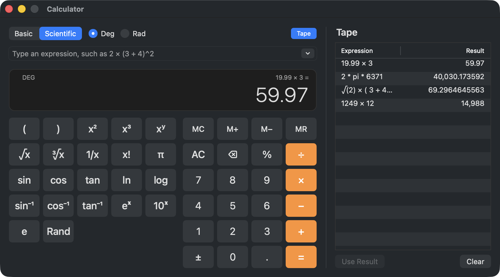
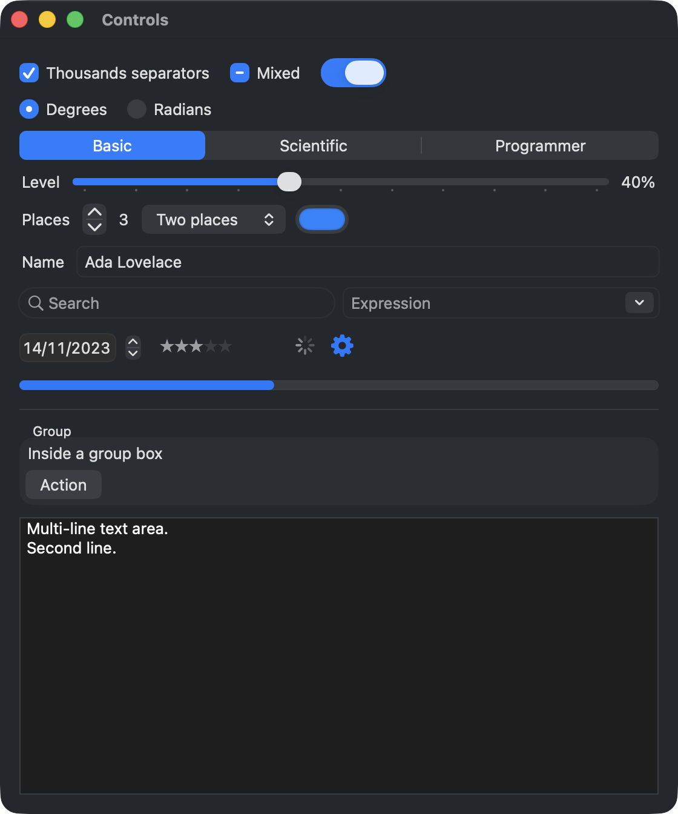
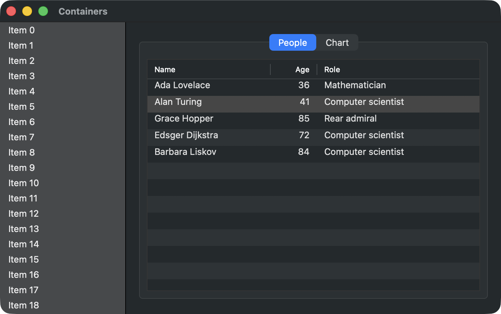
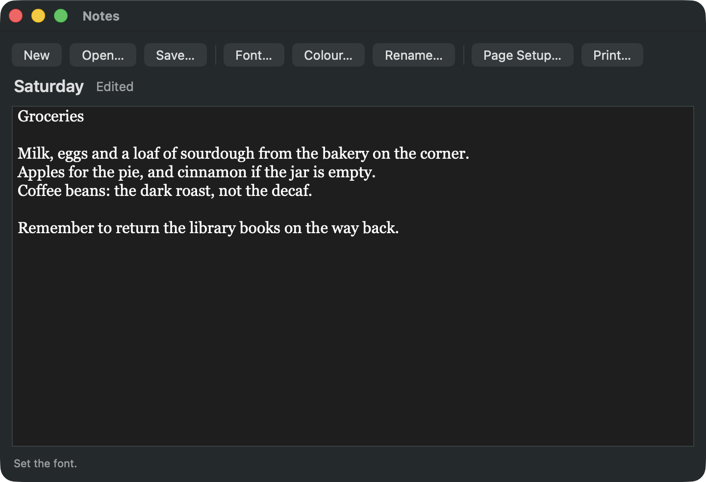
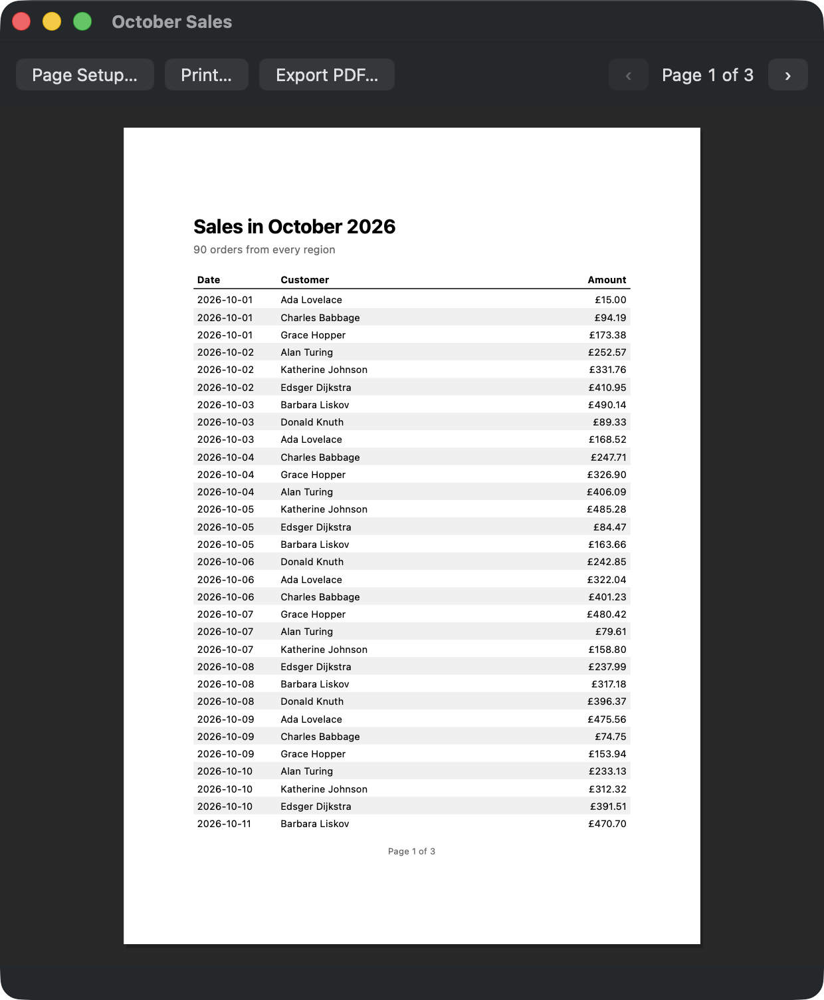

# zug

Zug is a toolkit for desktop applications in Zuri. 

<p align="center">
  <picture>
    <source media="(prefers-color-scheme: dark)" srcset="docs/images/calculator-light.png">
    
  </picture>
  <br>
  <sub>The <a href="examples/calculator">calculator</a> example. Every key, field and table in it is an AppKit control.</sub>
</p>

Zug UIs are built on a tree of native widgets built from the application's state.

Zug works out what changed and updates the native views to match just like Flutter and ReactUI does, except for Zug, every
control is the platform's native control. For example, on macOS a zug button is an `NSButton`, a
text field an `NSTextField`, a table an `NSTableView`, with the input
methods, accessibility, dark mode and behaviour that come with them.

<table>
  <tr>
    <td width="50%" align="center">
      <picture>
        <source media="(prefers-color-scheme: dark)" srcset="docs/images/controls-light.png">
        
      </picture>
      <br><sub>Controls, from <a href="examples/controls.zu">examples/controls.zu</a></sub>
    </td>
    <td width="50%" align="center">
      <picture>
        <source media="(prefers-color-scheme: dark)" srcset="docs/images/containers-light.png">
        
      </picture>
      <br><sub>Lists, tabs and tables, from <a href="examples/containers.zu">examples/containers.zu</a></sub>
    </td>
  </tr>
  <tr>
    <td width="50%" align="center">
      <picture>
        <source media="(prefers-color-scheme: dark)" srcset="docs/images/notes-light.png">
        
      </picture>
      <br><sub>Every dialog, from <a href="examples/dialogs.zu">examples/dialogs.zu</a></sub>
    </td>
    <td width="50%" align="center">
      <picture>
        <source media="(prefers-color-scheme: dark)" srcset="docs/images/report-light.png">
        
      </picture>
      <br><sub>Printing, from <a href="examples/printing.zu">examples/printing.zu</a></sub>
    </td>
  </tr>
</table>

<p align="center"><a href="docs/images">More screenshots</a>, each in light and dark.</p>

```zuri
import zug { * }

class Counter < StatefulWidget {
  create_state() {
    return CounterState()
  }
}

class CounterState < State {
  var count = 0

  build(context) {
    return Padding(
      EdgeInsets.all(20),
      Column(
        [
          Text(
            'Pressed ${self.count} times', {
              style: Style.of(context).headline,
            },
          ),
          Button('Press', {
            role: ButtonRole.PRIMARY,
            on_pressed: @{
              self.set_state(@{
                self.count++
              })
            },
          }),
        ],
        {
          spacing: 12,
          align_items: AlignItems.START,
        },
      ),
    )
  }
}

run_app(
  App({
    title: 'Counter',
    windows: [
      Window('Counter', Counter()),
    ],
  }),
)
```

## Requirements

- Zuri 0.1 or later.
- macOS 11 or later. It is developed and tested on Apple silicon; the
  Intel code paths are written but have not been tested. So we're looking for testers.

## Installing

Zug installs from its git repository:

```console
$ zuri install --git https://github.com/zuri-lang/zug.git
```

## Documentation

The [documentation](docs/index.md) covers every part of zug an
application uses. [Getting started](docs/getting-started.md) is the
place to begin. After that, most people reach for
[Layout](docs/layout.md), [Widgets and state](docs/widgets-and-state.md),
the [component reference](docs/components/index.md) and
[Testing](docs/testing.md).

## Examples

- `examples/hello.zu`: a counter.
- `examples/controls.zu`: every control that chooses a value.
- `examples/containers.zu`: scrolling, tabs, split panes, a table,
  drawing and pointer input.
- `examples/animation.zu`: a panel that eases open, a value that glides
  to new settings, and a pulse.
- `examples/services.zu`: keys, an alert, a timer, the clipboard and
  background work.
- `examples/dialogs.zu`: a notes editor that opens and saves files, asks
  before throwing changes away, restyles its text from the font and
  colour choosers, renames the note in a sheet of its own, and prints
  it with its text flowing from page to page.
- `examples/printing.zu`: a sales report that runs over several pages,
  with a header on each and page numbers, previewed in the window,
  printed, or exported as a PDF.
- `examples/images.zu`: an image viewer that shows an image file, turns
  it a quarter either way and flips it across or down.
- `examples/conformance.zu`: every widget zug has in one working window,
  the gallery the backend conformance check builds, with a switch that
  swaps every widget to a second set of options.

And a whole application, `examples/calculator`, its own project with its
own tests: keyed and typed calculations, a scientific keypad, memory, a
tape, and settings that persist.

## Testing

`zuri test` runs zug's tests on the headless backend, with no display.

The platform tests, such as `tests/macos.test.zu`, which drives real AppKit views and opens windows, run only when `ZUG_MACOS_TESTS=1` is set.

When you build applications with zug, your
application's tests should also use `zug.testing` the same way. See
[Testing](docs/testing.md).

## Other platforms

Everything that depends on the platform lives in a backend, so bringing zug to Linux,
Windows or anywhere else means writing a backend and nothing more.
[Writing a backend](docs/backends.md) describes the contract, and
`tools/check_backend.zu` checks a new backend against it.
