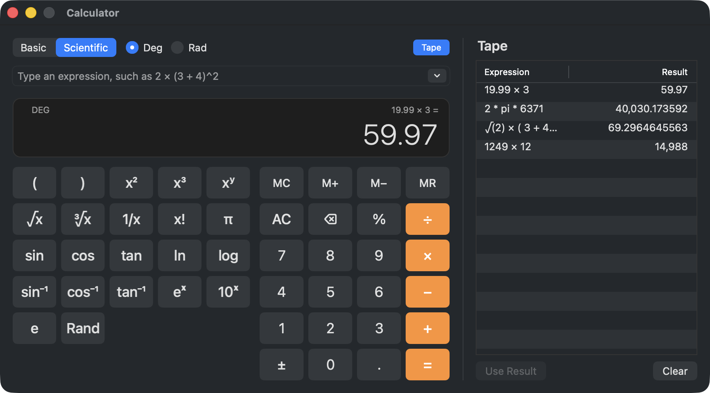

# zug documentation

zug is a toolkit for desktop applications in Zuri. You describe your
interface as widgets built from your application's state, and zug keeps
the platform's own controls in step with it.

  <picture>
    <source media="(prefers-color-scheme: dark)" srcset="images/calculator-light.png">
    
  </picture>
   
  The <a href="examples/calculator">calculator</a> example. Every key, field and table in it is an AppKit control.

This guides explain how zug works, roughly in the order you'll need it.
The [component reference](components/index.md) describes every widget,
with an example you can run and a table of its options.

## Start here

- [Getting started](getting-started.md): a new project, a first window,
  and the ideas everything else builds on.
- [Widgets and state](widgets-and-state.md): the widgets you write
  yourself, the life of a `State`, keys, the `Context`, and sharing data
  across the tree.
- [Layout](layout.md): how widgets decide their sizes, how to build the
  common layouts, and what to do when a layout goes wrong.

## Components

- [Component reference](components/index.md): every widget, grouped by
  what it's for.
  - [Text and images](components/text-and-images.md)
  - [Buttons](components/buttons.md)
  - [Choices](components/choices.md): checkboxes, switches, radio
    buttons, segmented controls and dropdowns
  - [Numbers, dates and colours](components/values.md)
  - [Progress and levels](components/indicators.md)
  - [Text input](components/text-input.md)
  - [Rows and columns](components/rows-and-columns.md)
  - [Boxes, spacing and sizing](components/boxes.md)
  - [Stacks, grids and tables](components/stacks-grids-and-tables.md)
  - [Scrolling and lists](components/scrolling-and-lists.md)
  - [Containers](components/containers.md): tabs, split views, group
    boxes, separators and materials
  - [Drawing and input](components/drawing-and-input.md)
  - [Animation](components/animation.md)
  - [Builders](components/builders.md)
  - [The application](components/app-and-windows.md): `App`, `Window`
    and menus

## Guides

- [Styling](styling.md): text styles, colours, a style sheet for the
  whole application, and light and dark.
- [Drawing and pointer input](drawing-and-pointer.md): the painter,
  paths, and building a control of your own.
- [Animation](animation.md): widgets that animate their own changes,
  animations you control, tweens and curves.
- [Applications, windows and menus](apps-windows-and-menus.md): opening
  and closing windows, the menu bar, and how keys travel through a
  window.
- [Timers, promises and the system](services.md): promises, timers, the
  clipboard, alerts, file dialogs, dialogs of your own, font and colour
  choosers, and work in the background.
- [Printing](printing.md): drawing pages, the print and page setup
  dialogs, and PDF files.
- [When something goes wrong](errors.md): how zug reports mistakes and
  errors, and how to handle them yourself.

## Testing and performance

- [Testing](testing.md): testing your interface without a display.
- [Performance](performance.md): what things cost, measured, and how to
  keep an application fast.

## Other platforms

- [Writing a backend](backends.md): the contract a platform implements,
  and how to check a new backend against it.
